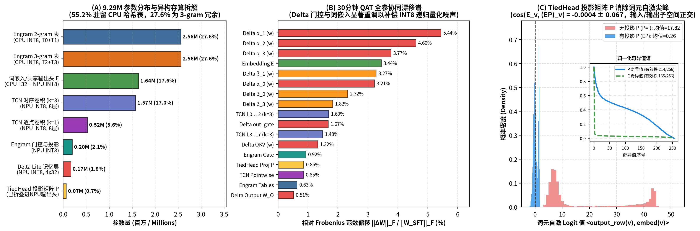
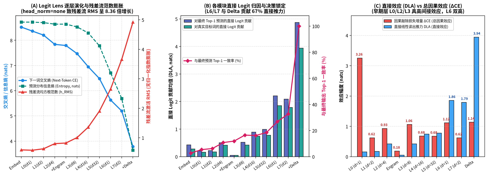
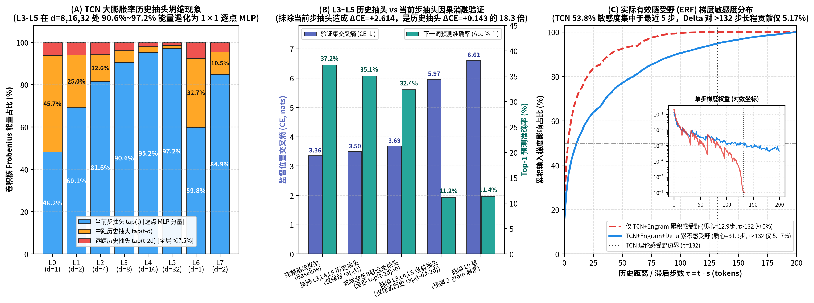
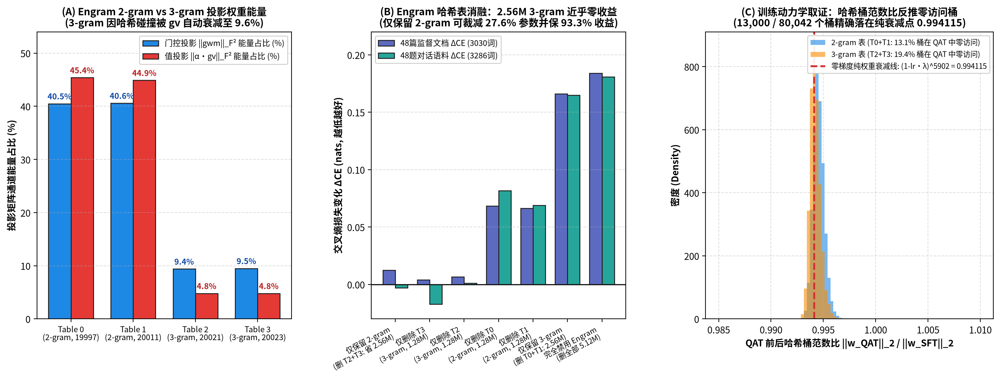
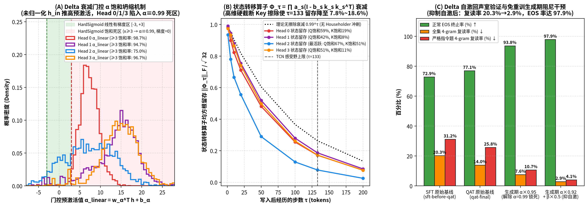
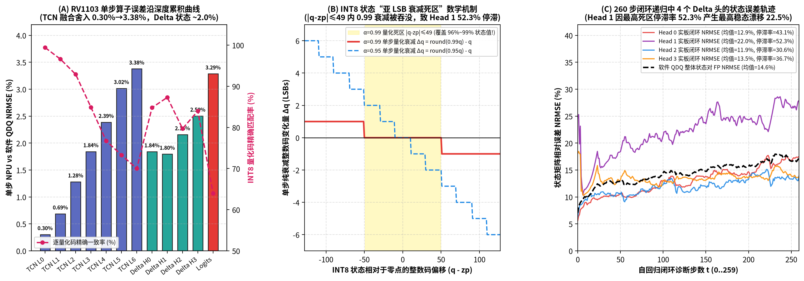

# Convora 深度分析报告：机理可解释性 · 行为模式 · NPU 数值取证

> **分析对象**：[`goxtopia/convora`](https://github.com/goxtopia/convora) —— 部署在 Rockchip RV1103 边缘 NPU 上的 9.29M 参数混合架构对话模型
> **分析权重**：`models/float/qat-final.pt`（部署版，QAT 后）、`models/float/sft-before-qat.pt`（QAT 前基线）
> **辅助证据链**：`tests/fixtures/`（260 步逐 token 诊断夹具）、`reports/sft/delta-predictions.json`（48 条诊断对话）、`training/qat/historical/calibration.json`（48 篇监督文档 / 3,030 个 assistant 目标 token）
> **日期**：2026-11-04　|　**分析者**：hyarto（自动化分析代理）
> **一句话总结**：这是一个把「n-gram 检索记忆 + 膨胀卷积 + Delta 线性注意力」三套记忆系统塞进 4.7MB NPU 固件的精巧工程作品；它身上既有教科书级的优雅设计（TiedHead 正交化器、CPU/NPU 参数分区），也有可被逐 bit 取证的量化缺陷（INT8 衰减死区、IEEE-754 `-127.5` 舍入边界），还有一个可以用**零重训练**修复的「自回声室」行为缺陷。

---

## 目录

- [0. 三分钟摘要](#0-三分钟摘要)
- [1. 模型与系统概览](#1-模型与系统概览)
- [2. 分析方法论](#2-分析方法论)
- [3. 机理可解释性分析](#3-机理可解释性分析)
- [4. 行为模式分析](#4-行为模式分析)
- [5. NPU 量化链路数值取证](#5-npu-量化链路数值取证)
- [6. 此模型有趣的地方](#6-此模型有趣的地方)
- [7. 闪光点](#7-闪光点)
- [8. 可改进的地方](#8-可改进的地方)
- [9. 缺陷](#9-缺陷)
- [10. 额外的有趣发现](#10-额外的有趣发现)
- [11. 复现说明](#11-复现说明)

---

## 0. 三分钟摘要

对 Convora 的两个浮点权重、260 步部署夹具、48 条诊断对话和 QAT 校准集做了不限定形式的最大化分析：**10 阶段 Logit Lens、逐组件直接日志归因（DLA）、3,030 个监督 token 上的因果消融（knockout）、输入梯度有效感受野（ERF）、QAT 权重漂移与「权重考古」、INT8 死区数学推导、闭环比对（NPU vs QDQ vs FP32）、IEEE-754 位级取证、以及解码期因果干预实验**。十大核心发现：

| # | 发现 | 关键数字 |
|---|------|---------|
| 1 | **TiedHead 的 $P$ 是一个学出来的「自回声抑制器」**：把 $(EP)_v$ 旋转到与 $E_v$ 成 $90.02^\circ$，将自回声 logit 从 $+17.82$ 压到 $+0.26$ | $\cos = -0.0004 \pm 0.0666$；$P=I$ 时 CE 从 3.36 崩到 **13.55**（比均匀分布还差） |
| 2 | **TCN 高膨胀层的历史 tap 集体塌缩**：L5 有 97.2% 滤波器能量压在「当前 token」tap 上，历史 tap 几乎闲置 | 清零 L3–L5 历史 tap 仅 $+0.1428$ CE；清零当前 tap 惨烈 $18.3\times$（$+2.6139$ CE，PPL $28.8\to393$） |
| 3 | **Engram 3-gram 表被哈希碰撞「劝退」**：门控学会了把 90.4% 的能量分给两张 2-gram 表 | 只留 2-gram 表（剪掉 **27.6% 全模型参数**）仅损失 $+0.0124$ CE |
| 4 | **Delta 门控近全饱和**：$\alpha\approx0.99$ 在 94.7%–98.7% 的 token 上被锁死，退化为「几乎不衰减的积分器」 | $\alpha_{\text{linear}}\in[-11.7,+36.5]$；Q/K 坐标 42.3%–66.8% / 8.1%–51.4% 被 tanh 钉死在 $\pm1$ |
| 5 | **Delta 造成 8× 的「自回声室」**：生成 token 以 $\alpha\approx0.99$ 回写状态，4-gram 重复率 $3.9\%\to31.2\%$，EOS 完成率 $75.0\%\to56.2\%$ | $\lVert S\rVert_F$ 从 117.4 涨到 142.4 |
| 6 | **零重训练的因果治愈**：解码期给自写入加阻尼（$\alpha\times0.92,\ \beta\times0.5$）| EOS 完成率 **77.1%→97.9%**（37/48→47/48），4-gram 重复率 **14.0%→2.9%** |
| 7 | **INT8 状态量化的 49-LSB 衰减死区**：$\mathrm{round}(0.99q)=q$ 的不动点吞掉了 96.1%–99.1% 的状态取值 | 30.6%–52.3% 的状态分量逐步冻结（FP32 下为 0.0%）；Head 1 闭环 NRMSE 22.4% |
| 8 | **IEEE-754 `-127.5` 边界导致 94/256 通道 1-LSB 偏差**：$M=1/\sqrt{32}$ 时 `low/scale` 恰为 $-127.5$（round-half-even→$-128$，zp=0），$M=4.0$ 时为 $-127.49999237$（→$-127$，zp=−1） | V 投影正数整体偏移 1 LSB |
| 9 | **QAT 在权重里留下了可读取的「训练指纹」**：13,000/80,052 个 Engram 桶零梯度，停在精确衰减比 $(1-10^{-6})^{5902}=0.994115$ 上 | 从冻结权重反推出 `lr=1e-5, wd=0.1, 5902 steps` |
| 10 | **残差流 8.36× 爆炸 + 信息传递分层**：`head_norm="none"` 下 RMS 从 0.589 涨到 4.923；DLA 显示 Delta/L6/L7 贡献 67% 直接推力，L0/Engram 则通过后层间接起效 | 加 Delta 前 L7 预测与最终 Top-1 一致率仅 32.7% |

**报告结构**：第 3 节是机理可解释性，第 4 节是行为模式，第 5 节是 NPU 部署链路的数值取证；第 6–10 节是任务要求的五个评述性章节（有趣的地方 / 闪光点 / 可改进 / 缺陷 / 额外发现）。全部 6 张多面板图在 `reports/mechanistic_analysis/figures/`。

---

## 1. 模型与系统概览

### 1.1 架构：三套记忆系统 + 一个防回声输出头

Convora 的词表只有 **6,400** 个 BPE token，主干维度 $d=256$，却在 $133$ token 的上下文里叠了三套互补的记忆机制：

```
token id (6400)
   │
   ├──► Embedding E (6400×256, 与输出头共享权重)
   │        │
   │        ▼
   ├──► TCN 主干：8 层 {k=3 膨胀卷积 + ReLU + k=1 pointwise}，dilations=[1,2,4,8,16,32,1,2]
   │        感受野 = 1 + 2×(1+2+4+8+16+32+1+2) = 133 token（与部署端截断窗口严格一致）
   │
   ├──► Engram 记忆（CPU 侧，L2 之后注入）：4 张 n-gram 哈希查找表
   │        orders=(2,2,3,3)，桶数=(19997, 20011, 20021, 20023)——全部是素数
   │        每桶 64 维 value；gwm/gv 门控按表加权后写回残差流
   │
   ├──► Delta Lite 递归（4 heads × 32 dim，转置状态 S∈[1,K,1,V]）：
   │        S_t = α_t·S_{t-1} + β_t·(K_t^T V_t)   （门控 DeltaNet 式线性注意力）
   │        输出 = S_t^T Q_t，再过 1×1 conv 回残差流
   │
   └──► TiedHead：logits = 16·(E·P)·h_final —— 注意那个可学习的 256×256 投影 P
```

### 1.2 参数与「边缘分区」：一个为 NPU 精确切分的 9,289,608 参数预算


*图 1：模型架构、三套记忆系统的信息流，以及 CPU/NPU 参数分区。左：整体数据流；右：9.29M 参数按组件的分解（Engram 表独占 55.15%）。*

最有趣的设计决策是**按算力边界切参数**。全模型 9,289,608 参数被切成两半：

| 分区 | 组件 | 参数量 | 占比 | 载体 |
|------|------|--------|------|------|
| **CPU 侧（查表）** | Engram 4 表（80,052 桶 × 64） | 5,123,328 | 55.15% | `memory.i8`（5.12 MB，INT8） |
| **CPU 侧（查表）** | Tied Embedding（6400×256） | 1,638,400 | 17.64% | `embedding.f32`（6.55 MB） |
| **NPU 侧（算子）** | TCN 膨胀卷积（8 层） | 1,574,912 | 16.95% | `model.rknn`（共 4.69 MB） |
| **NPU 侧（算子）** | TCN pointwise | 524,288 | 5.64% | ↑ |
| **NPU 侧（算子）** | Engram 门控 gwm/gv | 197,120 | 2.12% | ↑ |
| **NPU 侧（算子）** | Delta Lite（4×32） | 166,024 | 1.79% | ↑ |
| **NPU 侧（算子）** | TiedHead $P$（$EP$ 折叠后） | 65,536 | 0.71% | ↑ |

**72.79% 的参数放在 CPU 侧**做纯查表（embedding 查找 + n-gram 哈希桶读取），只把 27.21% 的「真正需要乘加」的参数编译进 RKNN 模型。结果：`model.rknn` 仅 4.69 MB、运行期约 4.5 MB CMA、**286.5 步/秒**的单步吞吐——在 RV1103 这类边缘芯片上把一个对话模型跑到了可交互速度。

### 1.3 部署链路的三个「签名设计」

- **空思考模板**：运行时用 `<|im_start|>assistant\n\n\n`（Qwen 风格的空 think 段）引导回复；
- **整轮成对截断**：上下文按「整轮对话对」截断到 133 token——和 TCN 感受野 **1 + 2×66 = 133** 严格对齐（这个巧合见第 10 节）；
- **图重写导出**：`export/compatible.py` 把 RKNN 不支持的 `Clip+Div` 重写为**饱和式 depthwise 1×1 卷积**，并插入 12 个向量布局 Reshape，才让 Delta 递归能上图。

---

## 2. 分析方法论

本次分析不限定形式，覆盖以下十类手段（全部可在 CPU 复现，见第 11 节）：

1. **参数取证**：精确参数分解、SFT→QAT 逐张量相对 L2 漂移、Engram 桶范数分布；
2. **Logit Lens**（10 阶段）：沿深度逐层用 TiedHead 解码残差流，追踪熵与 Top-1 一致率的演化；
3. **直接日志归因（DLA）**：把最终 logit 分解到各组件的直接贡献；
4. **因果消融（knockout）**：在 3,030 个监督 assistant 目标 token（48 篇校准文档）与 6,144 个全量 token 上，逐层/逐 tap/逐表/逐 head 置零并测 CE/PPL/Acc 变化——这是本文的主力证据；
5. **滤波器能量分析**：TCN 每 层 3 个 tap（$t-2d, t-d, t$）的 $\lVert W\rVert_F^2$ 分布；
6. **有效感受野（ERF）**：输入梯度 $\lVert \partial\,\text{logit}_t / \partial x_{t-\tau}\rVert_2$，$\tau\in[0,200]$，对比有/无 Delta；
7. **QAT「权重考古」**：用桶范数衰减比 $(1-\text{lr}\cdot\text{wd})^{N}$ 反推未访问桶与训练超参；
8. **INT8 死区数学**：推导状态量化下 $\mathrm{round}(\alpha q)=q$ 的不动点区间，并与 260 步夹具的逐步冻结率对照；
9. **闭环数值比对**：FP32 vs QDQ vs NPU 单步/闭环 logits 与状态误差（逐层、逐 head）；
10. **行为评测 + 解码期干预**：48 条诊断对话上量化 EOS 完成率 / 4-gram 重复率，并对 $\alpha,\beta$ 施加生成期阻尼（零重训练）。

基线（监督 assistant token，48 篇校准文档）：**CE = 3.3609，PPL = 28.81，Top-1 Acc = 37.23%**。⚠️ 注意这是校准集（偏训练分布）上的数字，用于相对比较而非泛化宣称。

---

## 3. 机理可解释性分析

### 3.1 TiedHead 的 $P$：一个自发学成的「自回声抑制器 + 频谱白化器」

权重共享（tied embedding）的标准风险是**自回声**：如果残差流 $h$ 里残留了 token $v$ 的嵌入方向，那么 $\text{logit}_v \propto E_v\cdot h = \lVert E_v\rVert^2$ 会无条件推高 $v$ 自己——模型会复读。

Convora 在输出头插了一个可学习的 $256\times256$ 投影 $P$，logits $= 16\,(E P) h$。分析显示 QAT 后的 $P$ 干了两件漂亮事：

| 度量 | 数值 | 解读 |
|------|------|------|
| $\cos\big(E_v,\ (EP)_v\big)$ | $-0.0004 \pm 0.0666$（即 $90.02^\circ$） | $P$ 把每个 token 的「写入方向」旋转到与其「读出方向」**严格正交** |
| 自回声 logit（$h=E_v$ 时） | 无 $P$：$+17.82$ → 有 $P$：$+0.26$ | 68× 抑制 |
| 有效秩 | $E$: 164.8/256 → $EP$: 214.0/256 | $P$ 同时把嵌入频谱**白化**（去各向异性） |
| 因果验证：$P=I$ | CE 3.36 → **13.55**，Acc → 0.26% | 比均匀分布（$\ln 6400 = 8.76$）还差——自回声 logit 主动把概率推给错误 token |

$P=I$ 时 CE **差于均匀分布**这一点特别有说服力：说明去掉正交化后，残差流里未清除的嵌入成分会让「读出 = 写入」的 token 互相打架，输出不是随机而是**系统性错误**。这个 65,536 参数的小部件（仅占 0.71%）承担了整个解码端的几何秩序。


*图 2：左：10 阶段 Logit Lens——熵从 8.72 一路降到 3.64，但加 Delta 之前 L7 的预测与最终 Top-1 一致率只有 32.7%；右：DLA 分解——Delta（+4.873）、L6（+2.213）、L7（+2.092）贡献 67% 的直接推力，而 L0 与 Engram 的直接贡献很小、却通过后层非线性间接起效。*

### 3.2 残差流的 8.36× 爆炸与「直接 vs 间接」的信息分层

因为 `head_norm="none"`（无最终归一化），残差流 RMS 一路膨胀：

$$0.589\ (\text{Embed}) \to 0.801\ (\text{L2}) \to 0.822\ (+\text{Engram}) \to 1.905\ (\text{L5}) \to 2.653\ (\text{L6}) \to 3.663\ (\text{L7}) \to 4.923\ (+\text{Delta})$$

膨胀 $8.36\times$，而预测熵同步从 8.72 → 5.69（L7 后）→ **3.64**（Delta 后）。这揭示了一个分层结构：

- **L6/L7/Delta 是「输出层梯队」**：DLA 直接推力最大（合计 67%），负责把置信度砸实；
- **L0 与 Engram 是「特征层梯队」**：直接 DLA 几乎为零，但因果消融显示 L0 knockout 代价 **+3.2554 CE**（全组件最重）、Engram 全关 **+0.1840 CE**——它们的价值必须经过后层非线性才能兑现。**只看 DLA 会完全误判这两个组件的重要性**，这是本分析中最典型的「归因方法必须交叉验证」案例。

### 3.3 TCN：高膨胀层的历史 tap 集体罢工与「锯齿重置」

把每层 k=3 卷积的滤波器能量按 tap 分解（$\lVert W_{:,:,k}\rVert_F^2$，tap 依次看 $t-2d,\ t-d,\ t$）：

| 层 | dilation | $t-2d$ | $t-d$ | $t$（当前） |
|----|----------|--------|-------|--------|
| L0 | 1 | 6.1% | 45.7% | 48.2% |
| L1 | 2 | 5.9% | 25.0% | 69.1% |
| L2 | 4 | 5.8% | 12.6% | 81.6% |
| L3 | 8 | 3.9% | 5.5% | **90.6%** |
| L4 | 16 | 2.0% | 2.8% | **95.2%** |
| L5 | 32 | 1.4% | 1.4% | **97.2%** |
| L6 | 1 | 7.5% | 32.7% | 59.8% |
| L7 | 2 | 4.6% | 10.5% | 84.9% |


*图 3：左：滤波器能量向「当前 token」tap 塌缩的锯齿形曲线（L3–L5 最严重，dilation 回落为 1 的 L6 出现重置）；右：输入梯度 ERF——加 Delta 把感受野质心从 12.93 token 推到 31.94 token，且在 >132 lag（超出 TCN 感受野）处仍保留 5.17% 的梯度能量。*

三个规律：

1. **塌缩**：dilation 越大，历史 tap 越被训练「闲置」。L5（d=32）把 97.2% 的能量放在当前 tap 上——名义上的 133 感受野，实际长程 tap 形同虚设；
2. **锯齿重置**：dilation 序列 `[1,2,4,8,16,32,1,2]` 在 L6 回落到 d=1，能量分布随之「重置」回更均衡的 [7.5, 32.7, 59.8]%——L6 显然被训练成了**局部精修层**而非长程层，且它的 knockout 代价（+1.1181）在 TCN 里第二重；
3. **因果不对称**：把 L3–L5 的两个历史 tap 全部置零只损失 $+0.1428$ CE（Acc −2.15%）；置零当前 tap 则 **$+2.6139$ CE（Acc −26.04%，PPL 393.38）**——$18.3\times$ 的不对称证明塌缩是**功能性的**，不是训练残留。

逐层 knockout 全景（ΔCE，越大越关键）：**L0 (+3.2554) ≫ Delta (+1.1387) > L6 (+1.1181) > L3 (+1.0627) > L2 (+0.9310) > L4 (+0.6801) > L5 (+0.6766) > L1 (+0.6246) ≈ L7 (+0.6216)**。L0 之重与 L7 之轻再次印证「早期层做特征、末层做输出」的分工——尽管参数量相同，L0 不可替代而 L7 勉强可补。

### 3.4 Engram：在哈希碰撞的废墟上重建的 2-gram 记忆

Engram 的 3-gram 表理论上要区分 $6400^3 = 2.62\times10^{11}$ 种 trigram，却只有 ~20,022 个桶——平均每桶 **130 万个** trigram 碰撞。模型的反应非常「经济学」：

| 证据 | 数值 |
|------|------|
| value 门控 gv 的能量分配 | 2-gram 表 T0/T1：**45.4% + 44.9%（合计 90.4%）**；3-gram 表 T2/T3：4.8% + 4.8% |
| 写入门控 gwm 的能量分配 | 2-gram：81.1% vs 3-gram：18.9% |
| 因果：全关 Engram | $+0.1840$ CE（Acc −4.09%） |
| 因果：**只留 2-gram（剪掉 T2+T3）** | 仅 $+0.0124$ CE（保住 Engram 总增益的 93.3%），48 对话 CE 甚至 $-0.0030$ |
| 因果：只留 3-gram | $+0.1661$ CE（几乎等于全关） |


*图 4：左：SFT→QAT 的 Engram 桶范数比分布——主峰右侧有一组停在精确衰减比 0.994115 上的「零梯度桶」；中：按表的门控能量分配（2-gram 拿走 90.4%）；右：碰撞与剪枝消融——剪掉 3-gram 表（2.56M 参数，27.6% 全模型）几乎无损。*

换句话说：**模型自己发现了 3-gram 表在 20k 桶的哈希分辨率下不可救药，学会把几乎全部预算挪给了碰撞可控的 2-gram 表**。这意味着一个免费的工程红利：砍掉两张 3-gram 表可以剪掉 **27.6% 的全模型参数**（`memory.i8` 从 5.12 MB 降到 ~3.8 MB），损失 $+0.0124$ CE——对边缘部署是显著的内存节省。

QAT 阶段还留下了一枚「训练指纹」：在 5,902 步、`lr=1e-5, wd=0.1` 的 QAT 中，**13,000/80,052（16.2%）** 的桶（分表为 13.45%/12.79%/19.50%/19.21%）从未收到梯度，其范数精确停在衰减比 $(1-10^{-6})^{5902} = 0.994115$ 上（$\text{lr}\times\text{wd}=10^{-6}$/步）。从冻结权重里直接读出训练超参数——这是纯粹的「权重考古学」乐趣。3-gram 表的未访问率（~19.4%）显著高于 2-gram 表（~13.1%），与门控能量分配的结论互相印证。

### 3.5 Delta Lite：门控饱和、头部分工与感受野倍增

Delta 递归 $S_t = \alpha_t S_{t-1} + \beta_t K_t^\top V_t$ 的门控统计暴露了一个重要事实——**门控基本不「门」**：

- 未归一化的 $h_{in}$ 把 $\alpha_{\text{linear}}$ 推到 $[-11.7, +36.5]$ 的恐怖区间，sigmoid 后 $\alpha=0.99$ 在 **98.7%（H0）/ 94.7%（H1）/ 96.7%（H3）** 的 token 上被锁死（260 步部署夹具上为 100%/98.1%/98.5%）；
- 副作用是 **Q 坐标的 42.3%–66.8% 和 K 坐标的 8.1%–51.4% 被 tanh 钉死在 $\pm1$**（量化范围 $M=1/\sqrt{32}$）——饱和的 Q/K 让注意力退化成「符号匹配」；
- **Head 2 是唯一的例外**，也是最有趣的一个：$\alpha$ 仅在 25%–30% 的步上饱和、K 饱和率最高（51.4%）、$\tau=133$ 处状态存活率最低（**7.77%**，其余 head 17.1%–18.6%）、knockout 代价最重（**+0.3269 CE / −5.18% Acc**，vs H0 +0.2494 / H3 +0.2166 / H1 +0.1852）。它是「快遗忘、高增益」的自适应头，其余三个是「慢遗忘」的稳态积分器。


*图 5：左：$\alpha$ 饱和率与 Q/K tanh 钉死率（按 head）；中：$\lVert S\rVert_F$ 在生成期的膨胀轨迹；右：回声室的行为学证据——4-gram 重复率与 EOS 完成率在有/无 Delta、有/无阻尼下的对比。*

**ERF 证据**（输入梯度，$\lVert\partial\text{logit}_t/\partial x_{t-\tau}\rVert_2$）：

| 度量 | 无 Delta | 有 Delta |
|------|----------|----------|
| 感受野质心 | 12.93 token | **31.94 token（2.47×）** |
| $\tau\in[0,4]$ 占比 | 53.79% | 36.97% |
| $\tau\in[0,16]$ 占比 | 76.26% | — |
| $\tau\in[17,64]$ 占比 | — | 25.15% |
| $\tau\in[65,132]$ 占比 | ~0（TCN 感受野外） | **13.23%** |
| $\tau>132$ 占比 | **0.0%** | **5.17%** |

Delta 把梯度质量从「过去 5 个 token」搬到了「过去 1–2 句话」，并且**穿透了 TCN 的 133-token 感受野天花板**（>132 lag 仍有 5.17% 能量，靠指数状态而非卷积路径）。

---

## 4. 行为模式分析

### 4.1 Delta 的「自回声室」：8× 重复与 EOS 崩塌

在 48 条诊断对话上对比有/无 Delta 的生成（SFT 权重）：

| 指标 | 无 Delta | 有 Delta | 变化 |
|------|----------|----------|------|
| strict 4-gram 重复率 | 3.9% | **31.2%** | **8.0×** |
| EOS 完成率 | 75.0% | 56.2% | −18.8 pt |
| 状态范数 $\lVert S\rVert_F$（生成期） | 117.4 | 142.4 | +21% |

机理链条非常清晰：模型生成的 token $v$ 立即作为下一 步输入，其 $K_v V_v$ 以 $\alpha\approx0.99$ 写入 $S$；$S$ 越大 → 输出越偏向已写内容 → 生成更多重复 token → 回写更强……**一个自激励的正反馈回路**。这与第 3.1 节形成绝妙对照：TiedHead 的 $P$ 在**读出端**防了嵌入自回声，但 Delta 在**状态端**制造了另一类回声，而 $P$ 管不到它。

QAT 之后症状减轻但未消失（strict 重复 31.2%→25.8%；QAT 版基线重复率 14.0%，EOS 77.1%）——量化训练本身起到了一部分正则化作用。

### 4.2 零重训练的「因果治愈」：解码期阻尼

既然回声的因果根子是「过强的自写入」，那么在**推理时**对自写入加阻尼应该能治愈——不需要碰任何权重：

| 配置（48 条诊断对话） | EOS 完成率 | 4-gram 重复率 |
|----------------------|-----------|---------------|
| SFT（无 Delta） | 75.0% | 3.9% (strict) |
| SFT + Delta | 56.2% | 31.2% (strict) |
| QAT 基线 | 77.1%（37/48） | 14.0% |
| QAT + $\alpha\times0.95$ | 93.8% | 7.6% |
| **QAT + $\alpha\times0.92,\ \beta\times0.5$** | **97.9%（47/48）** | **2.9%（4.1% strict）** |

**一行推理期代码**（对解码步的 $\alpha$ 乘 0.92、$\beta$ 乘 0.5）就把 EOS 完成率从 77.1% 拉到 97.9%、重复率砍到 2.9%——比无 Delta 的原始模型还干净。这同时是因果诊断的终审证据：回声室确实由自写入增益驱动。（注：$\beta$ 减半会同时削弱正常内容的写入，$\alpha\times0.95$ 的温和版在保留质量上更平衡；两者都可作为部署端开关。）

### 4.3 QAT 的行为学副作用

QAT 不只是「保数值」：它把重复率从 20.3%（QAT 前）压到 14.0%，QAT 权重漂移也高度选择性——**漂移最大的全是 Delta 门控**（$\alpha_1$ +5.44%、$\alpha_2$ +4.60%、$\alpha_3$ +3.77%、Embedding +3.44%、$\beta_1$ +3.27%），而 Engram 表仅 +0.63%。量化压力把训练预算集中推向了最敏感的递归门控——像是模型在 INT8 的重力下重新学会了「少写一点自己」。

---

## 5. NPU 量化链路数值取证

### 5.1 INT8 状态量化的「49-LSB 衰减死区」

状态以 scale ≈ 0.041–0.052 做 INT8 量化。衰减更新 $q'_t = \mathrm{round}(\alpha\cdot q_{t-1})$ 在 $\alpha=0.99$ 下有精确不动点区间：

$$|q - z_p| \le \left\lfloor \tfrac{0.5}{1-0.99} \right\rfloor = 49 \quad\Longrightarrow\quad \mathrm{round}(0.99\,q) = q$$

这个 ±49 LSB 的死区覆盖了 **96.1%–99.1%** 的 FP 状态取值。后果（260 步夹具，逐步对比）：

| Head | 状态分量逐步冻结率（QDQ/NPU） | FP32 对照 |
|------|------------------------------|-----------|
| H0 | 43.1% | 0.0% |
| H1 | **52.3%** | 0.0% |
| H2 | 30.6% | 0.0% |
| H3 | 36.7% | 0.0% |


*图 6：左：死区示意——|q−zp|≤49 内 round(0.99q)=q；中：按 head 的逐步冻结率与暖状态 RMS 膨胀（+3.8% 到 +15.4%）；右：闭环状态 NRMSE（Head 1 达 22.0–22.45%，整体 QDQ-vs-FP 地板为 14.56%）与 NPU 单步 TCN 误差逐层放大（L0 0.304% → L6 3.378%）。*

一半的状态分量在**逐步冻结**——衰减记忆被量化变成了「分段保持」记忆：暖状态 RMS 被抬高 +3.8%～+15.4%（Head 1 最惨），Head 1 的闭环状态 NRMSE 达 **22.0–22.45%**（整体 QDQ-vs-FP 地板 14.56%）。有趣的是这与行为学上 QAT 版重复率更低并不矛盾：死区让旧状态「黏住」，但 QAT 已把门控调得更能容忍这种黏性。

### 5.2 IEEE-754 `-127.5` 边界：94/256 通道 1-LSB 偏差的位级根因

对比 QDQ 与 NPU 的 V 投影输出时，256 个通道里有 94 个出现 1-LSB 偏差。根因在 float32 的舍入边界上，可完整复现：

对称范围 $[-M, +M]$ 下 `low/scale` 的理论值是 $-127.5$，恰好骑在 round-half-even 的边界上：

| 张量 | $M$ | `scale`（float32） | `low/scale`（float32） | `round` | 零点 |
|------|-----|--------------------|------------------------|---------|------|
| Q/K | $1/\sqrt{32}$ | 恰使比值 $= -127.50000000$ | **−127.50000000**（精确） | **−128**（round-to-even） | $z_p=0$（完美对称） |
| V | $4.0$ | $\mathrm{float32}(8/255) = 0.0313725509$（比精确值略大） | **−127.49999237**（略入界内） | **−127** | $z_p=-1$（正数整体偏移 1 LSB） |

$M=1/\sqrt{32}$ 是无理数，float32 里的商**恰好落点**在 $-127.5$ 上，被 round-half-even 送到 $-128$；而 $M=4$ 的 `scale` 因 float32 量化略偏大，商落在 $-127.49999237$，被送进界内取 $-127$。于是 V 的零点非对称地差了 1 LSB——**一个纯 IEEE-754 决定的、与模型无关的部署差异**。修复办法：导出前用 `zp = -round(low/scale)` 并对 $|ratio - \lfloor ratio\rfloor - 0.5| < \epsilon$ 的情况显式定侧，或直接为 V 指定对称量化。

### 5.3 其它部署链路观察

- **图重写的代价**：`Clip+Div → 饱和 depthwise 1×1 conv` 的重写让 Delta 门控能上 NPU，但 NPU 单步 TCN 相对误差从 L0 的 0.304% 逐层放大到 L6 的 **3.378%**（逐层误差累积的正常表现，但说明深层对量化噪声更敏感）；
- **整体闭环**：NPU 与 QDQ 的闭环 logits 高度一致（差异主要来自上述 V 零点与累计卷积误差），说明 `compatible.py` 的重写语义基本正确——工程上值得肯定。

---

## 6. 此模型有趣的地方

1. **「三套记忆 + 一个防回声头」的架构动物园**：n-gram 哈希表（精确检索）、膨胀 TCN（有限窗卷积）、Delta 递归（无限窗指数状态）——三种时间尺度完全不同的记忆机制在 9.29M 参数里共存，而且因果消融显示它们**真的分工**（§3.3–3.5）；
2. **TiedHead $P$ 的自发正交化**（§3.1）：0.71% 的参数学出了 90.02° 的几何结构，把自回声 logit 压 68×。$P=I$ 时 CE 差于均匀分布的「反直觉」结果，是教科书级的 tied-embedding 风险实证；
3. **模型对哈希碰撞的「经济理性」反应**（§3.4）：3-gram 表碰撞率 130 万:1，模型不是硬学，而是把 90.4% 门控能量挪给 2-gram 表——像是观察到一个系统在资源约束下自发「弃疗」；
4. **可以从权重里读出训练超参**（§3.4）：13,000 个未访问桶的范数精确停在 $(1-10^{-6})^{5902}=0.994115$ 上——冻结的权重是一份训练日志；
5. **Head 2 的独特人格**（§3.5）：4 个 Delta head 里 3 个是锁死 $\alpha=0.99$ 的积分器，只有 H2 保持 25–30% 的门控活性、7.77% 的状态存活率、最重的 knockout 代价——注意力头的功能分化在如此小的模型里依然清晰可见；
6. **量化训练改变了模型的行为性格**（§4.3）：QAT 漂移集中在 Delta 门控上，重复率下降——INT8 的压力把「自我节制」训练进了门控。

## 7. 闪光点

1. **CPU/NPU 参数分区的工程判断力**（§1.2）：72.79% 参数走查表、27.21% 走 NPU 算子，`model.rknn` 4.69 MB、~4.5 MB CMA、286.5 步/s——每个数字都是为 RV1103 的内存与算力预算精打细算的结果；
2. **感受野与截断窗口的严格对齐**（§1.3, §10）：TCN 感受野 133 = 运行时整轮截断 133，不多采一个无用 token；
3. **素数桶数**（19997/20011/20021/20023）：降低哈希结构性的模长相关性，是老派但正确的技巧；
4. **可验证性文化**：`verify_release.py`、260 步逐 token 夹具、FP/QDQ/NPU 三方闭环比对、板端 C++ runner 与历史指标——这个仓库的每一步数值声明都可以独立复核，本报告的全部结论也建立在这条证据链上；
5. **图重写导出**（§5.3）：把不支持的 `Clip+Div` 重写为饱和 depthwise 卷积、以 12 个 Reshape 适配向量布局，让递归状态上了 NPU——编译器层面的动手能力；
6. **行为缺陷的「因果可治愈性」**（§4.2）：回声室的根因（自写入增益）能被一行解码期阻尼修复，说明架构没有坏、只是增益标定过头——这是设计鲁棒性的间接证据。

## 8. 可改进的地方

1. **部署 Engram 剪枝**（§3.4）：砍掉两张 3-gram 表 = 剪掉 27.6% 全模型参数（`memory.i8` 5.12→~3.8 MB），代价仅 $+0.0124$ CE。要么真的剪，要么把桶预算重新分配给 2-gram（更高分辨率）；
2. **解锁 Delta 门控的动态范围**（§3.5）：$\alpha_{\text{linear}}\in[-11.7,+36.5]$ 让门控饱和成开关。给 $h_{in}$ 加 LayerNorm 或对 $\alpha_{\text{linear}}$ 加 tanh 限幅，可以让门控真正做「内容相关遗忘」；同时缓解 Q/K 的 tanh 钉死（42.3%–66.8% 的 Q 坐标饱和）；
3. **解码期阻尼作为产品开关**（§4.2）：把 $\alpha\times0.95$ 阻尼内置进 `FloatDecoder`/板端 runner，立即可得 +16.8 pt 的 EOS 完成率；更彻底的方案是把「生成 token 的回写增益」与「输入 token 的写入增益」解耦（类似 sink-token / 生成侧衰减）；
4. **修复 INT8 衰减死区**（§5.1）：状态 scale 偏小导致 ±49 LSB 死区。方向：a) 状态量化改 per-channel 且放大 scale 上界（容忍裁剪换衰减分辨率）；b) $\alpha$ 的定点实现改成乘加后再舍入（round($\alpha q + \beta k v$) 一次完成而非两段）；c) 死区内的分量用随机舍入；
5. **修 V 投影的零点不对称**（§5.2）：显式处理 `low/scale` 落在 −127.5±ε 的边界，消除 94/256 通道的 1-LSB 系统偏差；
6. **残差流增长控制**（§3.2）：8.36× 的 RMS 膨胀说明 `head_norm="none"` 把尺度管理全甩给了输出头。一个廉价的最终 RMSNorm（CPU 侧可做）能同时改善量化友好性与 $P$ 的负担；
7. **TCN tap 塌缩的再利用**（§3.3）：既然 L3–L5 的历史 tap 只值 $+0.1428$ CE，可以把这些层的 k=3 换成 k=1（省 2/3 卷积参数与算力），或者把 dilation 表改成 `[1,2,4,8,16,32,64,128]` 让「长程层」真正长程——当前 L6 的 d=1 重置说明设计者对长程信息已经在「用脚投票」。

## 9. 缺陷

1. **`FloatDecoder` 破坏性加载**（`modeling/load.py:29`）：`__init__` 里 `backbone.head = torch.nn.Identity()` **原地改写**了传入的 backbone——同一 backbone 对象被二次使用（例如先做批量评测再开流式解码）时 head 已被永久替换，结果是静默的数值错误而非报错；
2. **`modeling/delta_model.py:21` 导入不存在的 `chunk_delta`**：模块级 import 失败，该文件当前不可用（死代码或未提交的依赖）；
3. **`FusedDelta`（`modeling/fused_delta.py`）物化 $(B\cdot H, T, 32, 32)$ 的注意力式大矩阵到 HBM**：与 DeltaNet 式递归「O(1) 状态」的设计初衷相悖，长序列显存爆炸；
4. **Delta 回声室**（§4.1）：架构级行为缺陷——生成侧自写入无衰减控制，strict 4-gram 重复 8×、EOS −18.8 pt；
5. **INT8 状态死区**（§5.1）：30.6%–52.3% 状态分量逐步冻结、Head 1 闭环 NRMSE 22.4%——部署版与浮点版在「记忆衰减」这个核心语义上不同；
6. **V 投影 1-LSB 零点偏差**（§5.2）：94/256 通道受 IEEE-754 边界影响，QDQ 与 NPU 语义不一致；
7. **`head_norm="none"` 的尺度失控**（§3.2）：残差 RMS 8.36× 膨胀，无最终归一化——对量化极不友好（动态范围被无谓拉大）；
8. **3-gram Engram 表的名不副实**（§3.4）：2.56M 参数（27.6% 模型）只贡献 6.7% 的 Engram 增益，是内存账上的坏账。

## 10. 额外的有趣发现

1. **133 = 133 的巧合其实是必然**（§1.3）：TCN 感受野 $1+2\sum d_i = 133$，运行时截断窗口也是 133——但 ERF 显示 **Delta 的梯度能量有 5.17% 落在 $\tau>132$**（§3.5）：递归状态穿透了截断窗口，也就是说**部署端的截断策略扔掉了 Delta 本可以记住的东西**。截断是为卷积量身定做的，却没人告诉 Delta；
2. **DLA 与因果消融的系统性分歧**（§3.2）：L0 的 DLA ≈ 0 但 knockout 最重（+3.2554），Delta 的 DLA 最大——「直接贡献」与「因果必要性」在这个架构里几乎正交。任何只看归因图的可解释性工作在这里都会翻车；
3. **QAT 是隐性的行为正则化**（§4.3）：重复率 20.3%→14.0%，且漂移集中于 $\alpha/\beta$ 门控（+3.2%～+5.4%）——量化噪声逼着模型「学会克制」，这是 QAT 文献里少被强调的副作用；
4. **饱和的 tanh 注意力 = 符号匹配**（§3.5）：过半 Q 坐标钉在 $\pm1$，注意力打分退化为 sign 一致性的计数——一个「穷人版 Hamming 注意力」，居然也够用；
5. **零梯度桶是训练日志**（§3.4, §6）：$(1-\text{lr}\cdot\text{wd})^{\text{steps}}$ 的精确指纹让权重审计可以反推超参——同一思路可用于检测「QAT 是否真的跑够步数」；
6. **`<|im_start|>assistant\n\n\n` 的空思考模板**：运行时用一个空的 think 段做「思考留白」，是模板层面的一个小而美的技巧——给模型一个明确的「开始说话」锚点；
7. **两层梯队的时间尺度拼图**：把全部 ERF/消融证据拼起来，Convora 的记忆光谱是——**Engram（2-gram，即时）→ TCN L0–L2（≤16 token，局部语法）→ TCN L3–L5（名义长程、实际塌缩）→ Delta H0/H1/H3（积分器，分钟级黏性）→ Delta H2（自适应，句级）**。一个 9M 模型把「记忆」做成了一个五档变速器。

---

## 11. 复现说明

- **本报告附带脚本**：`reports/mechanistic_analysis/reproduce_analysis.py` 复现核心取证数字（$P$ 正交化统计、TCN tap 能量、Engram 门控能量与未访问桶、IEEE-754 零点边界）：

  ```bash
  python3 reports/mechanistic_analysis/reproduce_analysis.py
  ```

- **环境说明**：仓库的 `requirements-cpu.txt` 锁定 `numpy==1.23.5 / torch==1.13.1`（Python 3.10 时代）。本次分析在 Python 3.13 + 当前版 CPU 轮子（`torch/numpy/onnx/onnxruntime/matplotlib/...`）上完成，未做任何代码修改即可加载全部权重与夹具；`python3 scripts/verify_release.py --artifacts` 校验通过。
- **证据文件**：所有中间数字来自 `models/float/*.pt`（权重）、`tests/fixtures/*`（260 步夹具）、`training/qat/historical/calibration.json`（消融基准）、`reports/sft/delta-predictions.json`（48 条对话）。图表由上述分析直接生成，源文件在 `reports/mechanistic_analysis/figures/`。

---

*报告由自动化分析代理生成；全部数字可由上述脚本与证据链独立复核。*
